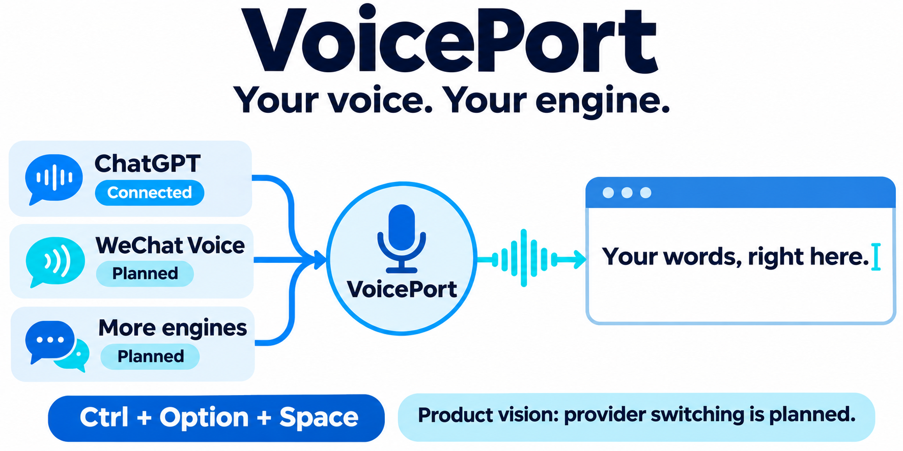
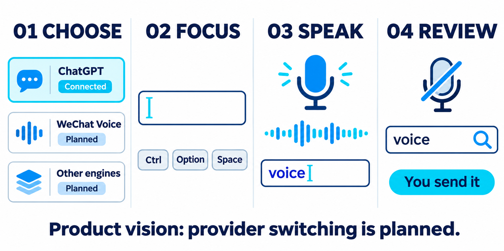

# VoicePort

**语音引擎随你选，文字落在光标处。**

VoicePort 的产品目标是提供一个统一的桌面语音输入入口：**ChatGPT、微信语音或其他识别引擎，按你的习惯选择和替换。** 更换识别来源后，仍沿用同一套快捷键、录音、预览与输入流程，将文字送到正在使用的编辑器或终端，由你检查并发送。

当前 macOS 开发版可在原生设置的「转写来源」下拉框中选择 **ChatGPT、Paraformer 本地流式或 Whisper Tiny 本地离线**。本地来源复用已安装的 Orca 模型与运行时，不联网；缺失的来源不会自动切换到云端。安装要求和限制见 [本地模型](docs/LOCAL_MODELS.md)。微信语音和通用自定义后端仍是产品方向；下图为早期概念示意。

<p align="center">
  
</p>

<p align="center">macOS 13+ · Rust 原生应用 · 当前开发版 0.3.3</p>

> **当前状态：** macOS 应用已实现录音、转写和受保护的自动输入路径；Orca 中的完整语音输入流程仍待真实试用确认。Windows 正在开发，尚不能用于桌面听写。上图及下方分镜均为通过 `image-use` 生成的概念示意，非应用截图或验收证据。

[识别引擎](#识别引擎按你的习惯选) · [快速开始](#快速开始) · [听写如何工作](#听写如何工作) · [平台支持](#平台支持) · [常见问题](#常见问题) · [开发与验证](#开发与验证)

## 为什么做 VoicePort

写需求、补充上下文、描述问题时，想法往往先于打字出现。你可能喜欢 ChatGPT 的识别结果，也可能习惯微信语音，或者希望使用其他服务。VoicePort 希望把“用谁来识别”和“在哪里输入”分开，让你换引擎时也能继续使用熟悉的输入方式。

**产品方向：识别引擎可以换，输入位置和操作习惯保持一致。**

| 能力 | 使用体验与状态 |
| --- | --- |
| 识别来源下拉框 | 可选择 ChatGPT、已安装的 Paraformer 或 Whisper Tiny；每次听写仅使用一个来源。 |
| 全局快捷键 | 已实现。在目标应用中开始、结束听写，应用常驻菜单栏。 |
| 本机实时预览 | Paraformer 提供本地流式文字；ChatGPT 可使用系统设备端预览；Whisper 无实时预览。 |
| 停录后转写 | 由所选来源生成最终文字；本地来源全程在本机完成。 |
| 保留你的控制权 | 已实现。不自动发送，不生成回车；焦点或输入内容变化时停止后续自动写入。 |
| 失败后可恢复 | 已实现。云端转写失败时保留已有本机预览；保留的录音可手动重试。 |

## 识别引擎，按你的习惯选

目标体验是：**选择识别引擎 → 定位输入光标 → 说话 → 检查文字**。来源可以不同，文字都通过 VoicePort 的统一输入流程进入目标位置。

| 来源 | 定位 | 当前状态 |
| --- | --- | --- |
| **ChatGPT 听写** | 系统设备端预览，停止后使用自己的 ChatGPT 登录转写。 | 默认来源，可在设置中更换。 |
| **Paraformer 本地流式** | 录音时持续产生部分文字，停止后在本地完成最终转写。 | 复用 Orca 已安装的中英双语模型，支持 arm64。 |
| **Whisper Tiny 本地离线** | 停止后在本地分段识别，无实时预览。 | 复用 Orca 已安装的 int8 模型，支持 arm64。 |
| **微信语音** | 作为可替换的识别来源，沿用相同快捷键和输入流程。 | 规划中，接入方式尚未确定。 |
| **其他识别服务 / 自定义后端** | 为不同语言、识别偏好或部署需求提供更多选择。 | 扩展方向，尚无通用插件、配置界面或自动发现机制。 |
| **macOS 设备端识别** | 录音期间提供本机实时预览。 | 已实现；目前是预览环节，不能作为可切换的最终转写后端。 |

当前版默认使用 ChatGPT，只有显式选择本地来源才改变数据去向。模型缺失或失败时会清楚报错，不自动回退；曾选中但丢失的模型仍显示为不可用。录音和重试固定使用开始时的来源与语言，更换设置不会重定向已有录音。“由你确认发送”的操作边界保持一致。

## 快速开始

以下步骤用于当前已经接入的 **ChatGPT 路径**。

### 1. 准备环境

当前提供源码构建的 macOS 开发包，需要：

- **macOS 13 或更新版本**。目前验证的是 Apple Silicon / arm64 构建。
- **Rust / Cargo 1.95+**，以及 macOS Command Line Tools（链接系统框架与签名）。无需 Swift 工具链。
- **Python 3**，用于打包和许可材料检查。
- 使用 ChatGPT 时，安装 **Codex CLI** 并通过自己的 ChatGPT 账号进行文件登录。本地模式无需登录；另需安装 [规定版本的 Orca 运行时和模型](docs/LOCAL_MODELS.md)。

当前没有经过公证的正式发行包；Intel Mac 和 Windows 安装包尚未完成验证。

### 2. 登录、构建、启动

```bash
git clone https://github.com/forwaryan/voiceport.git
cd voiceport

# 使用你自己的 ChatGPT 账号登录
codex login

# 首次构建或依赖缓存不完整时，先按锁文件下载依赖（此步需要网络）
cargo fetch --locked

# 离线构建 Rust 原生应用；输出目录必须尚不存在
CARGO_NET_OFFLINE=true bash scripts/package_app.sh

# 正常启动即显示结果与设置窗口
open dist/VoicePort.app
```

应用默认生成在 `dist/VoicePort.app`。如果该路径已有旧包，使用 `VOICEPORT_APP_DIRECTORY="$PWD/dist/VoicePort-Rust.app" bash scripts/package_app.sh` 选择新的输出路径，再打开对应的新包。打包不会覆盖已有应用。运行打包后的应用无需安装 Rust 工具链；构建细节见 [打包说明](docs/PACKAGING.md)。

应用常驻 **macOS 右上角菜单栏**，以紧凑的语音图标显示，不占用底部 Dock。图标随听写、转写或待处理状态变化，并适配系统深浅外观；悬停可看状态和快捷键。点击图标可打开结果与设置、开始或停止听写、复制最近文字。关闭设置窗口后应用继续运行，从右上角图标选择「打开结果与设置…」即可恢复窗口；重新打开应用也会恢复窗口。启动和重开窗口不会自动录音。快捷键注册冲突会显示在设置按钮上，可点击换一组。

如果右上角没有图标，请检查「系统设置 → 菜单栏」的显示开关。macOS 26 可能把终端启动的 VoicePort 归入启动应用（例如 Orca）的菜单栏组；此时 VoicePort 和该启动应用的显示开关都需要允许。菜单栏显示与「辅助功能」授权是两个独立设置。

应用与 CLI 优先使用非空 `CODEX_HOME` 下的 `auth.json`，否则使用 `~/.codex/auth.json`；CLI 还支持优先级更高的 `--auth PATH`。目前只支持 ChatGPT 文件登录，尚不支持 API key、仅保存在 Keychain 中的登录或应用内刷新登录。

### 3. 授予权限

| 权限 | 用途 | 未授权时 |
| --- | --- | --- |
| 麦克风 | 录制你主动开始的语音。 | 无法录音。 |
| 语音识别 | ChatGPT 来源的可选系统设备端预览；本地模型不申请此权限。 | ChatGPT 仍可停录后转写；本地来源不受影响。 |
| 辅助功能 | 确认原输入框、光标和文字输入能力。 | 自动输入开启时，会在录音前提示处理授权；也可关闭自动输入，仅转写到面板。 |

窗口分为 **听写** 和 **设置** 两个页签：听写页展示当前状态与本次文字，复制、取消、重试仅在适用时出现；完整诊断可从底部信息按钮查看。设置页使用原生开关及转写来源、语言、快捷键下拉选项；「刷新」重新检查已安装的本地模型，录音 / 转写期间不能更改设置。点击辅助功能一行的 **未授权 · 设置**，按提示在系统设置中允许当前的 VoicePort。也可先点击权限检查按钮（本地来源只检查麦克风），处理系统授权提示；这项显式权限准备不会开始录音。处理完权限后，回到目标应用，重新点好输入位置，再主动用快捷键或菜单开始听写。CLI 的 `doctor` 不申请或验证这些权限。

> **更新开发版后需要留意：** 本机包使用 ad-hoc 签名。更新程序后，辅助功能列表里的开关可能仍亮着，但旧授权已经失效。请移除旧 VoicePort 条目，再添加正在运行的 `dist/VoicePort.app` 并启用。应用会检查当前进程的实际权限。

### 4. 在原输入位置开始说话

1. 回到要输入文字的应用，点好光标位置。
2. 按 **Control + Option + Space** 开始听写。
3. 说完后，再按一次相同快捷键结束，等待最终转写。
4. 检查文字，由你自行发送。

单次录音最长 **3 分钟**。快捷键冲突时，可在设置中切换为 **Control + Shift + Space**；也支持从菜单栏开始或结束。

## 听写如何工作

<p align="center">
  
</p>

上图为早期概念示意；当前设置已有来源选择。**Paraformer 边说边在本机出字，Whisper Tiny 停止后本地识别，ChatGPT 则使用可选的系统设备端预览并在停止后上传转写。** 系统预览不可用时，ChatGPT 路径会说明原因并保留停录后转写；不会自动改用 Apple 云端语音识别。本地来源失败时不回退到云端。

不同输入位置有不同的处理方式：

| 输入位置 | 实时文字 | 最终转写 |
| --- | --- | --- |
| 支持读取文字、选区和辅助功能写入的普通输入框 | 只更新本次听写拥有的文字范围，保留两侧内容。 | 在原范围内替换预览，避免重复追加。 |
| Orca 的 `Terminal input` | 通过字符事件追加连续识别结果一致的前缀；停录时补入剩余本机文字。 | 只追加与已输入前缀一致的内容；需要改写已有文字的校正结果保留在面板。 |
| 未知、只读或无法确认能力的控件 | 文字保留在结果面板。 | 可手动复制。 |

听写时请保持原输入位置。切换焦点、编辑文字或移动光标可能使后续自动输入停止。密码字段与安全输入状态不会自动写入。

**终端里的文字一旦输入，取消不会将其撤回。** 应用不会通过删除已有 CLI 内容来强行套用校正结果，也不会自动按回车。自动输入会把换行和控制字符转换为空格，手动复制则保留原文。

## 平台支持

| 部分 | 当前状态 |
| --- | --- |
| macOS 菜单栏应用 | 已提供源码构建；包括录音、本机预览、云端转写、结果面板和输入权限检查。 |
| macOS 自动输入 | 已实现普通字段与 Orca 终端路径；具体应用兼容性和 Orca 完整语音输入仍需实测。 |
| Rust 转写 CLI / 子进程 | 已实现文件转写、取消、手动重试和有界 JSONL 宿主协议。 |
| Windows 桌面听写 | 开发中。采集所有权、后台执行和存储基础已合入；桌面 Start/Stop 尚未接通，不能作为可用的听写应用。 |

Windows 的目标编译检查不等于实机运行通过；设备、NTFS 权限、完整链接与打包仍有未完成的验证。详见 [Windows 状态](docs/WINDOWS.md) 和 [跨平台路线](docs/CROSS_PLATFORM.md)。

## 常见问题

### 能识别，但文字没有进入光标位置？

先看应用显示的具体输入状态。常见原因是辅助功能授权未生效、开始时焦点在 VoicePort 自己的窗口、原输入位置已经变化，或控件能力无法确认。

重新授权当前应用后，回到目标输入框，再用全局快捷键开始。仅在面板点“复制”不会自动投递。对保留录音执行手动重试时，也不会把旧文字自动写入新的输入位置。

### 没有实时预览，停录后才有文字？

先看所选来源：Whisper Tiny 本来就只在停止后出字；Paraformer 在本地模型载入后流式识别；ChatGPT 的实时预览依赖已授权的系统语音识别与设备端语言资源。自动识别、中文和 English 可在设置中选择。具体支持与限制见 [本地模型](docs/LOCAL_MODELS.md)。

### 无法连接 ChatGPT 转写服务？

确认 Codex 的 ChatGPT 登录可用，并检查网络。Rust 原生 macOS 应用直接使用系统中显式配置的 HTTPS 代理；应用与 CLI 均支持通过 `VOICEPORT_HTTPS_PROXY` 指定 HTTP / HTTPS 代理。代理 URL 不接受用户名或密码。

应用不会自动重传失败的录音；网络恢复后，可在结果面板选择 **重试这段录音**。

### 语音会发到哪里，是否保存历史？

- **本地来源全程在本机识别，不联网、不读取云端登录。** 只有选择 ChatGPT 时，停录后的录音才上传到 `chatgpt.com/backend-api/transcribe`，使用你自己的 ChatGPT 登录；该来源的可选实时预览也在设备端运行。
- 默认不保存转写历史或遥测，结果保留在内存中。录音位于 `~/Library/Caches/io.voiceport.rust-recordings-v1`，使用受限的目录与文件权限。
- 成功、取消或正常退出时会尝试删除本次录音；转写失败时可保留录音供手动重试。启动清理只处理严格超过 24 小时、归属确认且未占用的残留，并非到时必删。
- 该听写接口未公开承诺稳定性或用量规则，也不能仅凭端点相同就断言与 Codex App 的模型、识别质量或扣量方式相同。

## 命令行使用

Rust CLI 处理已有音频文件，不录音、不自动投递文字。macOS app 已实现录音、实时预览和受保护输入；具体应用兼容性与真实用户流程仍需验证。

```bash
# 缓存为空或不完整时先准备依赖；已有完整缓存可直接离线构建
cargo fetch --locked
CARGO_NET_OFFLINE=true cargo build --workspace --release --locked

./target/release/voiceport-rs --help

# 离线演示，不录音、不读取登录、不联网
./target/release/voiceport-rs demo

# 离线检查登录文件元数据，不读取或验证凭据
./target/release/voiceport-rs doctor

# 也可明确指定待检查文件；输出不会包含该路径
./target/release/voiceport-rs doctor --auth /path/to/auth.json

# 上传指定文件并转写；Ctrl-C 取消
./target/release/voiceport-rs transcribe /path/to/audio.m4a --language zh
```

`doctor` 沿用登录路径优先级：显式 `--auth PATH` > 非空 `CODEX_HOME/auth.json` > `HOME/.codex/auth.json`。它只查询文件系统元数据，首行以 `Codex 登录文件：` 开头，区分以下结果：

| 文件状态 | 诊断输出 |
| --- | --- |
| 普通文件，包括空文件或畸形内容 | `普通文件（未读取、未验证登录有效性）` |
| 文件未找到 | `未找到（请先通过 codex login 准备 ChatGPT 文件登录）` |
| 目录等非普通文件 | `不是普通文件（未读取、未验证登录有效性）` |
| 元数据检查失败，如符号链接循环 | `检查失败（无法确认文件状态，未读取或验证凭据）` |

文件存在不等于有效登录。`doctor` 不读取、解析或验证凭据，不登录、刷新或联网，也不申请或验证麦克风、语音识别及辅助功能权限；输出不包含选中路径、凭据或底层错误文本。上述四种状态均表示诊断完成，退出码为 **0**；参数错误仍为 **2**，实际转写运行错误为 **1**，取消为 **130**。真实账号、录音、云端转写和目标接收需分别验证。

支持 m4a/mp4、wav、mp3、webm、ogg、flac，文件上限 **20 MB**。可使用 `--auth PATH` 指定登录文件。macOS 应用直接链接 Rust 核心；CLI 与其 JSONL 宿主协议是单独的集成入口。

集成子进程可使用 `voiceport-rs host`。协议、消息大小、超时和会话边界见 [宿主协议](docs/HOST_PROTOCOL.md)。

## 开发与验证

```bash
# 与 CI 一致使用 Rust 1.95.0；工具链需已安装 rustfmt 和 clippy
export RUSTUP_TOOLCHAIN=1.95.0

# 冷缓存先联网准备锁定依赖，再进行离线检查
cargo fetch --locked
export CARGO_NET_OFFLINE=true

# Rust 工作区测试、格式和严格 Clippy
bash scripts/test_rust.sh

# 也可分别检查 Rust 共享核心与 macOS 应用
bash scripts/test_core.sh
bash scripts/test_app.sh

# 完整离线自检，使用新的临时应用包，不覆盖 dist 中的旧包
python3 -I scripts/verify.py
```

macOS 原生模块位于 `crates/voiceport-macos`：AppKit 界面、AVAudio 录音与设备端 Speech、Accessibility 与终端字符投递均由 Rust 实现。应用行为检查使用合成 PCM、隔离存储和模拟输入目标，不会自动启动真实录音或向你的输入框写字。旧 Swift 源码、测试及 SwiftPM 清单已从当前文件树移除，历史实现可通过 Git 历史查看。历史 Swift 检查结果不作为 Rust 新实现的验收。

`verify.py` 本身假设依赖缓存已准备，缺少依赖时应先运行上面的 `cargo fetch --locked`。完整流程覆盖 Rust 测试、格式、严格 Clippy、release 构建、临时打包、CLI 离线行为、LoopTests 和完整 PackagingTests。可选的 `python3 -I scripts/verify.py --app-smoke` 会额外执行不录音、不联网的菜单启动与输入权限输出检查；直接运行权限诊断得到的输出不证明 Launch Services 下的有效 TCC 身份。这些检查与 `doctor` 分属不同入口，均不替代真实麦克风、账号转写或 Orca 接收验收，详见 [验证边界](docs/VALIDATION.md) 与 [打包说明](docs/PACKAGING.md)。

[macOS CI](.github/workflows/ci.yml) 在 pull request 和 `main` push 时运行，使用 `macos-15` 与 Rust **1.95.0**。它先执行 `cargo fetch --locked` 准备锁定依赖，再设置 `CARGO_NET_OFFLINE=true`，依次运行 Rust 测试、格式和严格 Clippy、工作区 release 构建、LoopTests 与完整 PackagingTests。release 构建在 PackagingTests 之前完成，供真实临时应用包检查使用；CI 不进行真实登录、权限申请、录音或云端转写。

| 继续阅读 | 内容 |
| --- | --- |
| [方案说明](docs/SOLUTION.md) | 产品目标、技术方案与实现背景。 |
| [跨平台路线](docs/CROSS_PLATFORM.md) | Rust 共享核心、原生 macOS 与 Windows 迁移范围。 |
| [Windows 状态](docs/WINDOWS.md) | 已实现的基础能力与未完成的原生验证。 |
| [宿主协议](docs/HOST_PROTOCOL.md) | Rust JSONL 子进程接口。 |
| [进度记录](progress.md) / [任务计划](task_plan.md) | 历史开发、返修与阶段验收记录。 |
| [开发 Loop](docs/LOOP_METHODS.md) / [会话轮换](.claude/COORDINATOR_ROTATION.md) | 协作、独立验证与交接规则。 |
| [第三方许可](THIRD_PARTY_NOTICES.md) | 依赖与参考项目的许可说明。 |

插图通过 `image-use` 直接调用 Codex 的 `gpt-image-2-codex` 图像工具生成，采用简洁的产品插画风格；实际生成参数与提示词见 [配图说明](docs/images/README.md)。
