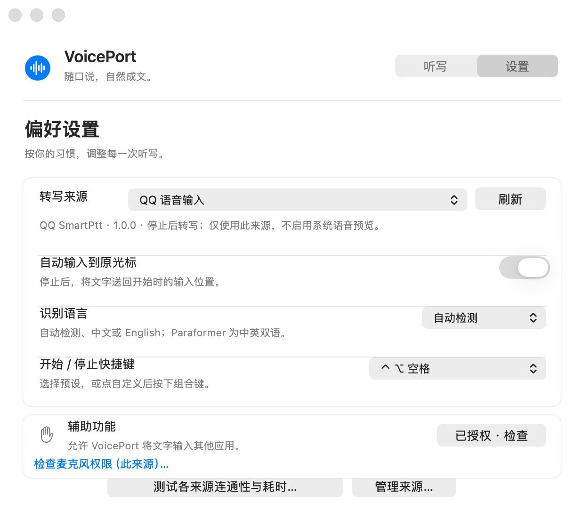
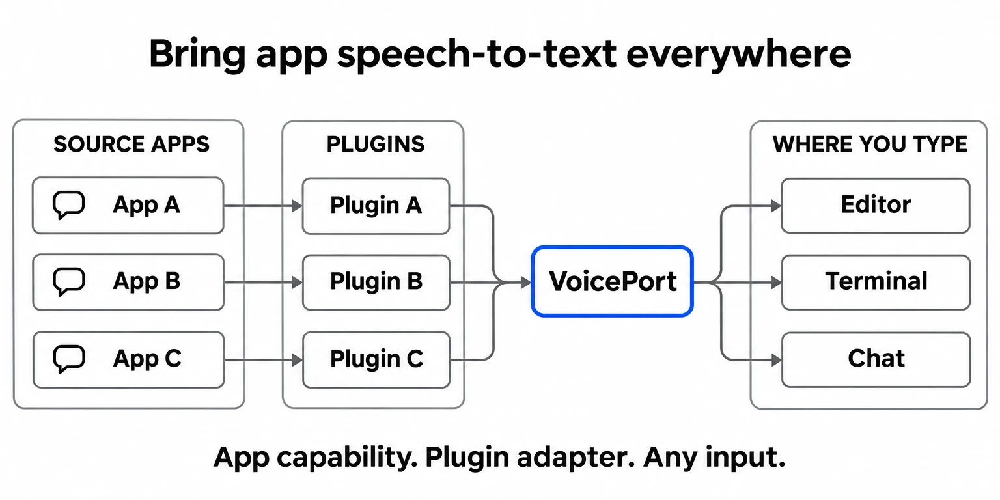

<h1 align="center">VoicePort</h1>

<p align="center">
  <b>插件化的语音能力转接器</b> — 把 App 的语音转文字能力，带到每一个输入框。
</p>

<p align="center">
  <a href="https://github.com/forwaryan/voiceport/releases/tag/v0.3.8"></a>
  <a href="https://www.rust-lang.org/tools/install"></a>
  <a href="#平台支持"></a>
  <a href="LICENSE"></a>
</p>

<p align="center">
  <a href="#为什么需要-voiceport">介绍</a> ·
  <a href="#快速开始">快速开始</a> ·
  <a href="#通过插件接入-app">插件接入</a> ·
  <a href="#已有来源">已有来源</a> ·
  <a href="docs/USAGE.md">使用指南</a> ·
  <a href="#命令行与集成">命令参考</a> ·
  <a href="skills/voiceport-plugins/SKILL.md">接入 Skill</a> ·
  <a href="#常见问题">FAQ</a>
</p>

<p align="center">
  
</p>

<sub>macOS 开发版真实界面，展示已配置的实验性 QQ 来源；不是开箱即用的 QQ 安装流程。</sub>

## 为什么需要 VoicePort

VoicePort 是一个**插件化的语音能力转接器**：把不同 App 已有的语音转文字功能接出来，作为统一的听写来源，再把结果输入你正在使用的 App。

你选择哪个 App 来识别，也选择在哪个 App 里写字。插件处理来源 App 的调用差异；VoicePort 统一录音、快捷键、结果预览与文字输入。接入一个来源，就可以在编辑器、终端、聊天窗口等不同输入场景中复用。

喜欢一个 App 的语音识别，不代表你只想在那个 App 里输入文字。

例如，接入 QQ 的语音转文字能力后，你可以将它选为听写来源，在其他 App 的输入框中使用，无需回到 QQ 录音再复制结果。QQ 的适配由插件负责，原输入位置的文字投递由 VoicePort 负责；当前 QQ 接入仍需单独配置，见 [桥接说明](scripts/qq_bridge/README.md)。

同样的接入方式可以扩展到其他具备可调用转写能力的 App：

- **复用 App 的语音能力**：通过适配插件调用已有 App 的转写能力，让识别结果进入统一的输入流程。
- **在其他 App 中使用**：同一个来源可以用于不同输入位置，不要求目标应用自带语音识别或安装专用插件。
- **接入更多来源**：除 App 适配器外，也支持兼容 HTTP 服务、本地模型；新增来源不需要改动目标应用。
- **保持同一套操作**：选来源、点光标、按快捷键说话，再按一次结束。你检查文字并自行发送。

**当前支持 macOS 13+ / Apple Silicon，可下载开发预览包或从源码构建。** 每种来源需要可用的接入方式，目标输入框也有兼容条件；预览包使用 ad-hoc 签名，尚无经过公证的正式发行包。Intel 与 Windows 状态见 [平台支持](#平台支持)。

## 通过插件接入 App

一个插件定义“怎样调用这个 App 或服务”，一个来源保存“这次使用哪一份配置”。同一插件可以配置多个来源，每次听写选择其中一个。

<p align="center">
  
</p>

<sub>插件转接机制示意，使用 image-use 生成；通用 App 表示可扩展方向，具体接入需要对应适配器。</sub>

| 你想接入什么 | 接入方式 | 从哪里开始 |
| --- | --- | --- |
| **已有 App 的语音转文字能力** | 编写或安装适配器，把 App 的可调用能力转换成 VoicePort 插件协议。 | [JSONL 插件契约](docs/TRANSCRIPTION_PLUGINS.md) |
| **提供兼容音频转写 API 的服务** | 在界面填写地址、模型与独立密钥，无需编写适配器。 | [HTTP 接入说明](docs/CUSTOM_SOURCES.md) |
| **其他协议的服务或本机识别程序** | 由适配器处理调用方式，对 VoicePort 返回统一的文字结果。 | [接入示例](skills/voiceport-plugins/references/examples.md) |

插件负责各个 App 的调用差异，VoicePort 复用录音、来源选择、结果面板与文字输入。因此，**接入一个新的语音 App，扩展的是所有目标输入场景可选用的识别来源**。

### 接入一个已有插件

1. 安装插件作者提供的本机适配程序，取得 VoicePort JSON 清单。
2. 打开「添加转写方式… → 导入本地插件…」，确认程序及参数。
3. 在插件卡片中填写配置、启用来源，然后在菜单栏中选用。
4. 回到目标输入框，用全局快捷键开始听写。

导入清单不会执行程序；保存配置不会联网。插件所依赖的 App、账号或服务需要另行准备，当前没有自动安装适配器的插件市场。外部插件以当前用户权限运行，可能联网。

### 为一个 App 编写插件

适配器接收 VoicePort 提供的 WAV 音频、语言与来源配置，调用对应 App 或服务，再返回识别文字。VoicePort 无需了解该 App 的内部调用细节；插件也无需为每个目标编辑器分别实现输入。

v1 使用本机程序的 stdin/stdout 交换单次 JSONL 请求与结果，支持停录后批量转写。清单、可执行参考程序和协议限制见 [插件开发指南](docs/TRANSCRIPTION_PLUGINS.md)。

不知道如何开始时，点击「用 AI 帮我接入…」，复制接入说明并附上服务或 App 的相关文档；也可以读取随 App 提供的 [插件接入 Skill](skills/voiceport-plugins/SKILL.md)。只有 App 名称或下载链接，仍需先确认实际可用的调用方式。

## 已有来源

| 来源 | 接入状态 | 出字方式与依赖 |
| --- | --- | --- |
| **ChatGPT** | 内置，默认来源 | 可选 macOS 设备端预览，停录后使用自己的 ChatGPT 文件登录转写。 |
| **QQ SmartPtt** | 实验性 App 适配器，单独配置 | 已有短合成语音转写记录；需要独立桥接副本、正常登录与联网，未随 VoicePort 打包。 |
| **Paraformer** | 内置本地来源 | 本机流式识别，需要指定的 Orca arm64 运行时与中英双语模型。 |
| **Whisper Tiny** | 内置本地来源 | 停录后在本机识别，需要指定的 Orca arm64 运行时与 int8 模型。 |
| **兼容 HTTP 服务** | 内置接入方式 | 连接你配置的音频文件转写接口，停录后返回文字。 |
| **更多 App 与服务** | 通过外部 JSONL 插件扩展 | 由对应适配器提供；v1 为停录后转写，不提供外部流式协议。 |

QQ 桥接展示了“把已有 App 的转写能力接出来”的一种实际路径，目前仍需手动准备；普通官方安装的一键接入、长音频与其他版本尚未完成验证。详见 [QQ 桥接说明](scripts/qq_bridge/README.md)。微信语音识别尚未接入。

本地模型与运行时不随 App 分发，不会自动下载，要求见 [本地模型](docs/LOCAL_MODELS.md)。HTTP 与 JSONL 来源不要求安装 Orca，也不使用 Codex 登录。来源缺失或调用失败时会报错，不自动切换到其他来源。

## 快速开始

### 1. 下载或构建并安装

**直接使用开发预览版**：从 [Releases](https://github.com/forwaryan/voiceport/releases) 下载 macOS arm64 ZIP，按发布附件中的 `INSTALL.zh-CN.md` 安装，并用 `SHA256SUMS.txt` 校验。下载包对应其发布标签，可能落后于 `main`；最新源码功能使用下面的构建方式。预览包尚未经过 Apple 公证，更新后可能需要重新授权。

**从源码构建**需要 **macOS 13+ / Apple Silicon**、[Rust 工具链](https://www.rust-lang.org/tools/install)、macOS Command Line Tools 和 **Python 3.11+**。以下使用与 CI 一致的 Rust 1.95.0；运行打包后的应用不需要 Rust 或 Swift 工具链。

```bash
git clone https://github.com/forwaryan/voiceport.git
cd voiceport

rustup toolchain install 1.95.0 --profile minimal
export RUSTUP_TOOLCHAIN=1.95.0
cargo fetch --locked

# 使用新的构建目录；日常安装位置保持固定
mkdir -p dist
package_dir="$(mktemp -d "$PWD/dist/package.XXXXXX")"
CARGO_NET_OFFLINE=true \
  VOICEPORT_APP_DIRECTORY="$package_dir/VoicePort.app" \
  bash scripts/package_app.sh

python3 -I scripts/install_app.py "$package_dir/VoicePort.app" \
  --destination "$HOME/Applications/VoicePort.app" --quit-idle
open "$HOME/Applications/VoicePort.app"
```

启动后点击右上角菜单栏的 VoicePort 图标，通过快捷面板选择来源或打开完整界面。正常启动不会自动录音。

更新时，安装器检查签名连续性并拒绝替换忙碌或保留待处理结果的实例。ad-hoc 开发包可能需要重新授权；详细构建参数与更新方法见 [打包说明](docs/PACKAGING.md) 和 [安装、签名与更新](docs/MACOS_UPDATES.md)。

### 2. 选一个来源

- **先试默认来源**：安装 [Codex CLI](https://github.com/openai/codex)，执行 `codex login`，准备自己的 ChatGPT 文件登录。该来源不支持用 API key 替代登录，也不在应用内刷新登录。
- **接入其他 App**：准备对应适配程序与清单，在「添加转写方式…」中导入、配置并启用。
- **连接服务或本地模型**：按 [HTTP 接入](docs/CUSTOM_SOURCES.md) 或 [本地模型](docs/LOCAL_MODELS.md) 准备后，在来源列表中选择。

### 3. 点好光标，开始说话

1. 在设置中准备**麦克风**权限；需要自动输入时，再准备**辅助功能**权限。
2. 回到要输入文字的 App，点好光标。
3. 按 **Control + Option + Space** 开始说话，再按一次结束。
4. 检查文字，由你自行发送。

快捷键可自定义，单次录音最长 **3 分钟**。只有 ChatGPT 的可选设备端预览需要系统语音识别权限，未授权仍可停录后转写。菜单栏操作、来源测试与权限排障见 [使用指南](docs/USAGE.md)。

## 在不同 App 中输入

VoicePort 的来源与目标是独立选择的：更换识别来源，不需要更换正在写字的 App；更换输入位置，也可以继续使用原来的来源。

| 目标场景 | 输入方式 |
| --- | --- |
| **编辑器与普通文字输入框** | 根据控件能力，更新本次听写范围或在停录后输入最终文字。 |
| **终端与命令行输入** | 使用对应的字符输入路径；不自动按回车，已写入的内容不会因取消而撤回。 |
| **聊天窗口、网页与自定义编辑区** | 根据兼容能力使用分段键入或最终文字粘贴。 |
| **无法自动写入的输入位置** | 识别结果保留在面板，可手动复制。 |

自动输入不会发送消息。焦点、光标或正文变化时，会停止后续写入；粘贴路径使用剪贴板。密码、安全输入、明确只读或禁用的控件不会自动写入。

“在任意 App 使用”是面向输入场景的产品目标，当前具体兼容性以 [输入路径与实测记录](docs/INPUT_DELIVERY.md) 为准。手动重试保留原识别来源，不会把旧录音的结果自动写入新的输入位置。

## 常见问题

<details>
<summary><strong>是不是换一种模型的语音输入法？</strong></summary>

VoicePort 的核心是通过插件转接已有的语音能力。来源可以是一个 App、远程服务或本地模型；目标可以是另一个 App 的输入框。模型选择只是其中一种用法，App 适配器让原本局限在某个软件中的识别能力进入统一输入流程。

</details>

<details>
<summary><strong>有语音转文字功能的 App，都能直接接进来吗？</strong></summary>

需要为该 App 找到可用的调用方式，并提供对应适配器。插件协议让这些接入方式可以扩展，不意味着导入一个 App 名称就能自动使用其内部功能。当前已有接入见上表；不同 App 的登录、运行环境与服务要求由各自适配器说明。

</details>

<details>
<summary><strong>音频会发到哪里？</strong></summary>

Paraformer 与 Whisper 在本机处理，不联网、不读取云端登录。ChatGPT 在停录后上传到其转写端点；HTTP 发往你配置的地址；App 适配器或其他 JSONL 插件可能调用自己的网络服务。各来源凭据独立保存，自定义来源不转发 Codex 登录。

默认不保存转写历史或遥测，结果保留在内存中。临时录音在成功、取消或正常退出时尝试删除，失败时可保留供手动重试。ChatGPT 接口的稳定性、模型与用量没有公开承诺。更多说明见 [来源与数据流向](docs/CUSTOM_SOURCES.md) 和 [插件契约](docs/TRANSCRIPTION_PLUGINS.md)。

</details>

<details>
<summary><strong>识别成功，但没有输入到目标 App？</strong></summary>

查看结果面板中的输入状态，检查当前安装版的辅助功能权限，再回到目标位置点好光标。部分控件不支持自动写入，或只允许确认粘贴请求已提交；当前文字可从面板复制。菜单栏、权限、网络与输入排障见 [使用指南](docs/USAGE.md)。

</details>

## 命令行与集成

```bash
voiceport="$HOME/Applications/VoicePort.app/Contents/MacOS/voiceport"
"$voiceport" --json status
"$voiceport" --json sources list
"$voiceport" skills get plugins
"$voiceport" skills get plugin-examples
```

CLI 可通过本机 IPC 复用运行中的 App，管理来源与插件，并读取版本匹配的接入指南。它不会隐式启动 App；CLI 听写需要显式开始，固定关闭自动投递。独立的 `transcribe` 文件命令仅使用 ChatGPT。

命令、JSON 输出与退出码见 [CLI 文档](docs/CLI.md)，程序间集成见 [宿主协议](docs/HOST_PROTOCOL.md)。

## 平台支持

| 平台 | 当前状态 |
| --- | --- |
| **macOS 13+ / Apple Silicon** | 原生菜单栏应用的开发实现，可从源码构建；来源与输入兼容性需分别确认。 |
| **Intel Mac** | 尚未完成构建与运行验证。 |
| **Windows** | 基础代码已合入，桌面听写 Start/Stop 尚未接通。 |

详见 [验证边界](docs/VALIDATION.md)、[Windows 状态](docs/WINDOWS.md) 与 [跨平台路线](docs/CROSS_PLATFORM.md)。

## 开发与贡献

欢迎扩展 App 适配器、完善输入兼容性，或通过 [Issues](https://github.com/forwaryan/voiceport/issues) 报告问题。接入新 App 时，请说明实际调用方式、环境要求和已验证范围；输入问题请提供系统版本、目标 App、来源与复现步骤。

```bash
rustup toolchain install 1.95.0 --profile minimal --component rustfmt --component clippy
export RUSTUP_TOOLCHAIN=1.95.0
cargo fetch --locked
export CARGO_NET_OFFLINE=true

bash scripts/test_rust.sh
# 完整离线自检，另需 Python 3.11+ 与 Node.js 22+
python3 -I scripts/verify.py
```

离线检查不会开始真实录音或上传音频；设备、服务调用与目标接收需要分别验证。[macOS CI](.github/workflows/ci.yml) 使用锁定依赖执行相应检查。

| 文档 | 内容 |
| --- | --- |
| [插件开发](docs/TRANSCRIPTION_PLUGINS.md) / [接入 Skill](skills/voiceport-plugins/SKILL.md) | 清单、协议、参考适配器与 AI 接入指引。 |
| [QQ 桥接](scripts/qq_bridge/README.md) | 一个已有 App 的实验性接入、依赖与当前限制。 |
| [使用指南](docs/USAGE.md) / [输入兼容性](docs/INPUT_DELIVERY.md) | 菜单栏、快捷键、权限和不同输入目标。 |
| [HTTP 来源](docs/CUSTOM_SOURCES.md) / [本地模型](docs/LOCAL_MODELS.md) | 服务配置与本机识别依赖。 |
| [CLI 与 Skill](docs/CLI.md) / [宿主协议](docs/HOST_PROTOCOL.md) | 本机控制、文件转写与程序集成。 |
| [构建打包](docs/PACKAGING.md) / [更新与签名](docs/MACOS_UPDATES.md) | 构建、安装、签名、公证与恢复。 |
| [技术方案](docs/SOLUTION.md) / [验证边界](docs/VALIDATION.md) | 架构背景、实测记录和未验证范围。 |

## 许可

VoicePort 采用 [MIT License](LICENSE)，允许使用、修改、分发及商业使用，分发时须保留版权和许可声明。软件按原样提供，不附带担保。第三方代码与依赖保留各自的许可，详见 [项目与第三方许可声明](THIRD_PARTY_NOTICES.md)。

配图的生成记录与文档结构参考见 [素材说明](docs/images/README.md)。
